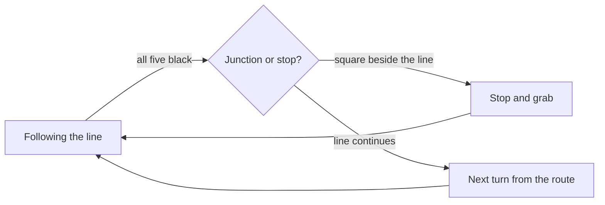

<Entry time="10:30">

We got to try the official arena today for the first time. I was quietly confident. Eight clean laps at home, battery fix in, steering tuned.

It rolled up to the very first junction and just stared at it.

</Entry>

<Entry time="12:10">

The practice mat I printed is one loop with curves. The real arena has junctions: places where the line crosses another line, or splits in a T. At a junction, all five sensors see black at once.

And back on day 10 I'd used "all five black" to mean "this is the pickup stop, wait for a block". So at the first junction the robot stopped, opened its gripper, and waited politely for a block that was never coming.

</Entry>

<Compare>
  <Photo src="/content/builder-log/line-follower/photo-40-mat.png" alt="Placeholder photo of the home practice mat." caption="Home mat: one loop, no junctions" />
  <Photo src="/content/builder-log/line-follower/photo-40-arena.png" alt="Placeholder photo of the official arena." caption="Real arena: junctions everywhere" />
</Compare>

<Entry time="18:40">

The stops in the real arena are marked with a small square beside the line, not across it. So the robot needs to tell "line crossing" from "stop marker", and it needs a plan for what to do at each junction. That's the next week of work.

</Entry>



<Toggle title="How it will tell a junction from a stop">

At 140 PWM the robot covers about 1 cm every 25 ms. The tape is 2 cm wide, so a junction crossing gives roughly 50 to 80 ms of "all five black".

A stop marker in the arena is a 5 cm square on one side only, so the outside sensor on that side stays black for around 200 ms while the opposite outside sensor sees white.

The new check, run on every reading:

```cpp
if (allBlack()) {
  junctionTicks++;
} else if (junctionTicks > 0) {
  // just left a crossing — take the next turn from the route list
  takeTurn(route[nextJunction++]);
  junctionTicks = 0;
}

if (outerLeftBlack() && outerRightWhite()) markerTicks++;
else markerTicks = 0;

if (markerTicks * 5 > 150) stopAndGrab();   // 5 ms per loop, 150 ms on the marker
```

The route is a list like LEFT, STRAIGHT, RIGHT, written for each arena layout before the run.

</Toggle>
